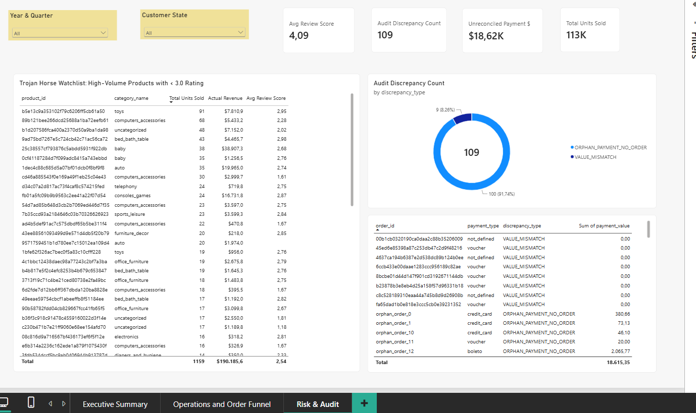
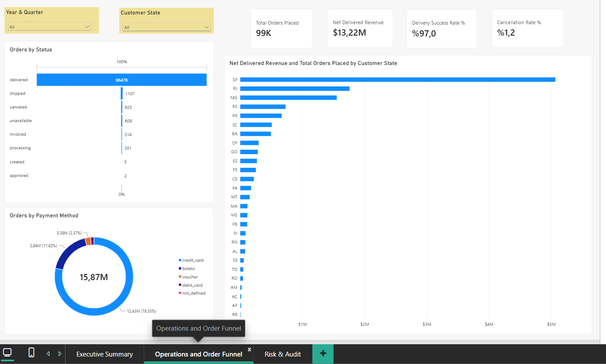
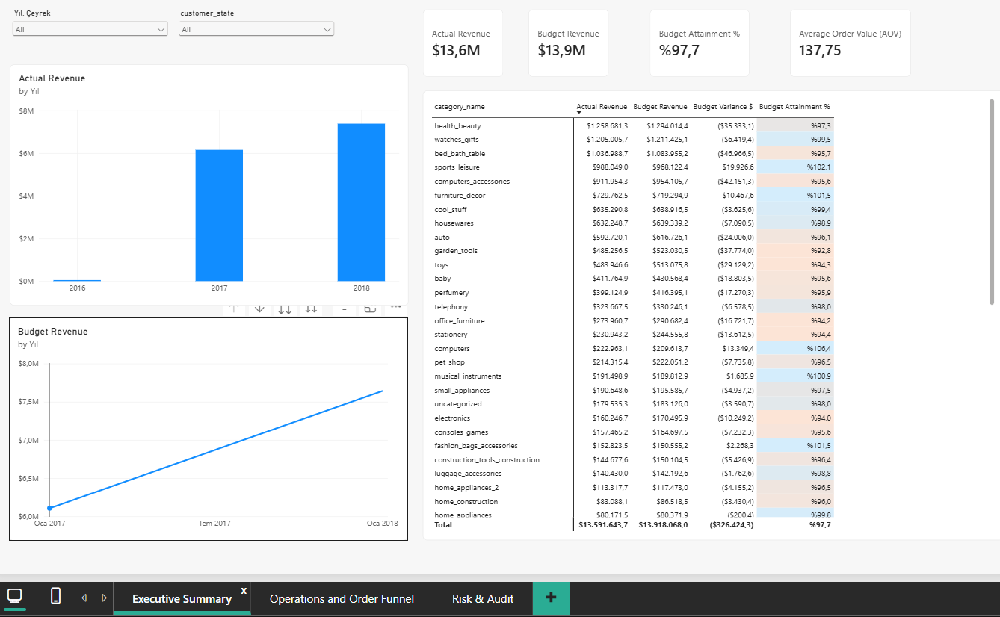
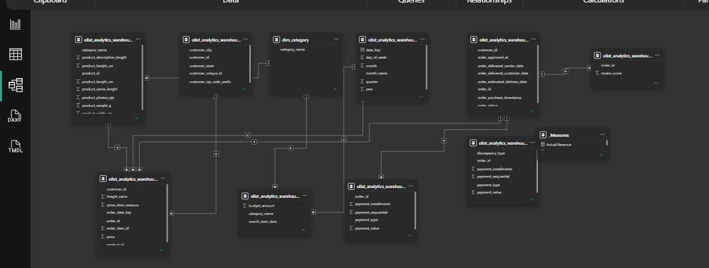

# E-Commerce Data Analytics Dashboard

An end-to-end analytics project built on the [Olist Brazilian E-Commerce dataset](https://www.kaggle.com/datasets/olistbr/brazilian-ecommerce) from Kaggle. I designed an ETL pipeline, deliberately introduced data quality issues to simulate messy real-world data, and resolved them during the cleaning process. The cleaned data is modeled as a **star schema** and analyzed with **DAX measures** to surface key business insights in an interactive dashboard.

🇹🇷 [Türkçe özet için aşağıya bakın](#türkçe-özet)

**Quick links:** [Dashboard page 1](docs/dashboard_overview1.png) · [Dashboard page 2](docs/dashboard_overview2.png) · [Dashboard page 3](docs/dashboard_overview3.png) · [Data model](docs/model_view.png) · [Power BI file](dashboard/)

---

## Table of Contents

- [Project Overview](#project-overview)
- [Dashboard Preview](#dashboard-preview)
- [Workflow](#workflow)
- [Project Structure](#project-structure)
- [Dataset](#dataset)
- [Getting Started](#getting-started)
- [Data Quality Issues](#data-quality-issues)
- [Data Model](#data-model)
- [Key Insights](#key-insights)
- [Tech Stack](#tech-stack)
- [Author](#author)
- [Türkçe Özet](#türkçe-özet)

---

## Project Overview

Real-world data is rarely clean. Instead of working only with a tidy dataset, this project simulates the full data journey:

1. **Break it:** A data generator introduces realistic errors into the raw Olist data.
2. **Fix it:** An ETL pipeline detects and corrects those errors.
3. **Model it:** The cleaned data is organized into a star schema.
4. **Analyze it:** DAX measures and an interactive dashboard present the key insights.

## Dashboard Preview

Click any image to open it in full size.

<p>
  <a href="docs/dashboard_overview1.png"></a>
  <a href="docs/dashboard_overview2.png"></a>
  <a href="docs/dashboard_overview3.png"></a>
</p>

## Workflow

```
raw_data  ──►  data_generator  ──►  dirty_data  ──►  etl_pipeline  ──►  clean data  ──►  dashboard
(Olist CSVs)   (injects errors)     (messy data)     (cleans & loads)   (star schema)    (DAX + visuals)
```

## Project Structure

```
.
├── dashboard/        # Power BI dashboard (.pbix)
├── data_generator/   # Scripts that introduce errors into the raw data
├── docs/             # Documentation, screenshots and diagrams
├── etl_pipeline/     # ETL scripts that clean and transform the data
├── raw_data/         # Original Olist CSV files (not tracked, see below)
├── dirty_data/       # Generated messy data (not tracked, can be regenerated)
├── .gitignore
└── README.md
```

> `raw_data/`, `dirty_data/` and `venv/` are listed in `.gitignore` and are not included in the repository.

## Dataset

This project uses the **Brazilian E-Commerce Public Dataset by Olist**, available on Kaggle:
[kaggle.com/datasets/olistbr/brazilian-ecommerce](https://www.kaggle.com/datasets/olistbr/brazilian-ecommerce)

Because the raw files are not included in this repository, download the dataset and extract the CSV files into the `raw_data/` folder. Please check the dataset's page on Kaggle for its license and attribution requirements.

## Getting Started

**Prerequisites:** Python 3.x and Power BI Desktop (to open the dashboard).

```bash
# 1. Clone the repository
git clone <repository-url>
cd <repository-folder>

# 2. Create and activate a virtual environment
python -m venv venv
venv\Scripts\activate          # Windows
# source venv/bin/activate     # macOS / Linux

# 3. Install dependencies
pip install -r requirements.txt

# 4. Create the raw_data/ folder and download the Olist dataset into it (see Dataset section)
mkdir raw_data

# 5. Generate the messy data (writes to dirty_data/)
python data_generator/<script_name>.py

# 6. Run the ETL pipeline
python etl_pipeline/<script_name>.py
```

> **Note:** Git does not track the folders listed in `.gitignore` (`raw_data/`, `dirty_data/`, `venv/`), so they do not exist after cloning. Create `raw_data/` yourself, and `dirty_data/` as well unless the generator script creates it.

<!-- TODO: Replace <script_name> with your real file names, confirm that the generator creates dirty_data/ (otherwise add a mkdir step), and add a note about where the cleaned data is saved and how the dashboard connects to it. -->

Then open the `.pbix` file in the `dashboard/` folder with Power BI Desktop. The report already contains its data, so it opens without running the pipeline. To refresh it with newly generated data, update the data source path in Power BI (**Transform data > Data source settings**) to point to your own cleaned data.

## Data Quality Issues

To mimic real-world conditions, the following kinds of errors were deliberately introduced and then fixed by the pipeline:

<!-- TODO: Replace this table with the issues you actually injected, for example:
| Issue | How it was introduced | How the pipeline fixes it |
|---|---|---|
| Missing values | ... | ... |
| Duplicate records | ... | ... |
| Incorrect data types | ... | ... |
-->

| Issue | How it was introduced | How the pipeline fixes it |
|---|---|---|
| **Duplicate Orders** | Injected 500 duplicate `order_id` rows to simulate double-fired webhook events. | Deduplicated in SQL using `ROW_NUMBER() OVER (PARTITION BY order_id)` to keep only the latest record. |
| **Locale Decimal Formatting** | Converted 2% of numeric prices from periods to commas (e.g., `190.40` to `190,40`). | Standardized strings and enforced numeric types using `CAST(REPLACE(price, ',', '.') AS DECIMAL(10,2))`. |
| **Orphan Payments** | Added 100 payment records referencing non-existent order IDs (`orphan_order_0` to `99`). | Isolated via `LEFT JOIN` anti-join and quarantined into the `audit_payment_discrepancies` table instead of deleting. |
| **Payment Value Anomalies** | Altered payment amounts and retained zero-value transactions to create reconciliation gaps. | Flagged `payment_value <= 0` and mismatched records into `audit_payment_discrepancies` for finance review. |

## Data Model

The cleaned data is modeled as a **star schema**: a central fact table connected to dimension tables, which keeps DAX measures simple and report performance high.

[](docs/model_view.png)

<!-- TODO: List your tables, for example:
- Fact table: ...
- Dimension tables: ...
-->

### Example DAX Measures

<!-- TODO: Add 2-3 of your own measures, for example:
```dax
Total Revenue = SUM(FactOrders[Revenue])
```
-->

## Key Insights

<!-- TODO: Add 3-5 concrete findings from your dashboard, with numbers where possible, for example:
- The category with the highest revenue is ...
- Average delivery time is ... days, and ...
-->

## Tech Stack

- **Python:** data generator and ETL pipeline
- **Power BI:** interactive dashboard
- **DAX:** measures and calculations
- **Star schema modeling:** analytical data model

## Author

**Yusuf Ökmen**: [GitHub](https://github.com/YusufOkmen) | [LinkedIn](https://www.linkedin.com/in/yusuf-okmen/)

---

## Türkçe Özet

Bu proje, Kaggle'daki **Olist e-ticaret veri setini** kullanarak hazırladığım uçtan uca bir veri analitiği çalışmasıdır. Gerçek dünya verisi nadiren temiz olduğu için veriyi bilerek hatalı hale getirdim (`data_generator`), bu hataları bir **ETL pipeline** ile tespit edip düzelttim (`etl_pipeline`), temizlenen veriyi **yıldız şema (star schema)** ile modelledim ve **DAX ölçüleriyle** analiz ederek önemli içgörüleri interaktif bir dashboard'da sundum.

**İş akışı:** Ham veri → hata üretimi → kirli veri → ETL ile temizleme → yıldız şema → DAX ve dashboard.

**Klasörler:**
- `dashboard/`: Dashboard dosyası
- `data_generator/`: Ham veriye hata ekleyen betikler
- `etl_pipeline/`: Veriyi temizleyip dönüştüren ETL betikleri
- `docs/`: Dokümantasyon, ekran görüntüleri ve şema diyagramları
- `raw_data/` ve `dirty_data/`: Boyutları nedeniyle repoya dahil edilmemiştir (`.gitignore`)

**Çalıştırma:** `.gitignore` içindeki klasörler repoda bulunmadığı için önce `raw_data/` klasörünü oluşturun (gerekirse `dirty_data/` klasörünü de), Olist veri setini Kaggle'dan indirip `raw_data/` klasörüne çıkarın, sanal ortam oluşturup `pip install -r requirements.txt` ile bağımlılıkları kurun, ardından önce `data_generator`, sonra `etl_pipeline` betiklerini çalıştırın. Dashboard için `dashboard/` klasöründeki dosyayı Power BI Desktop ile açın. Rapor verisini kendi içinde barındırdığı için pipeline'ı çalıştırmadan da açılır; yeni üretilen veriyle yenilemek için veri kaynağı yolunu kendi temizlenmiş verinize göre güncelleyin.

**Ekran görüntüleri:** [Dashboard sayfa 1](docs/dashboard_overview1.png) | [Dashboard sayfa 2](docs/dashboard_overview2.png) | [Dashboard sayfa 3](docs/dashboard_overview3.png) | [Veri modeli](docs/model_view.png)

**Kullanılan teknolojiler:** Python, Power BI, DAX, yıldız şema modelleme.
